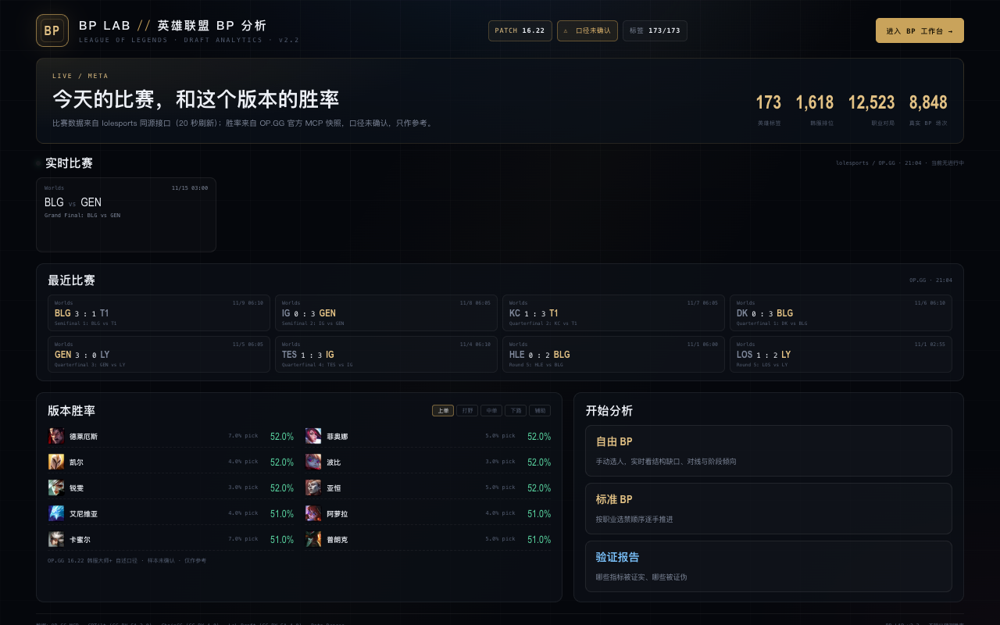
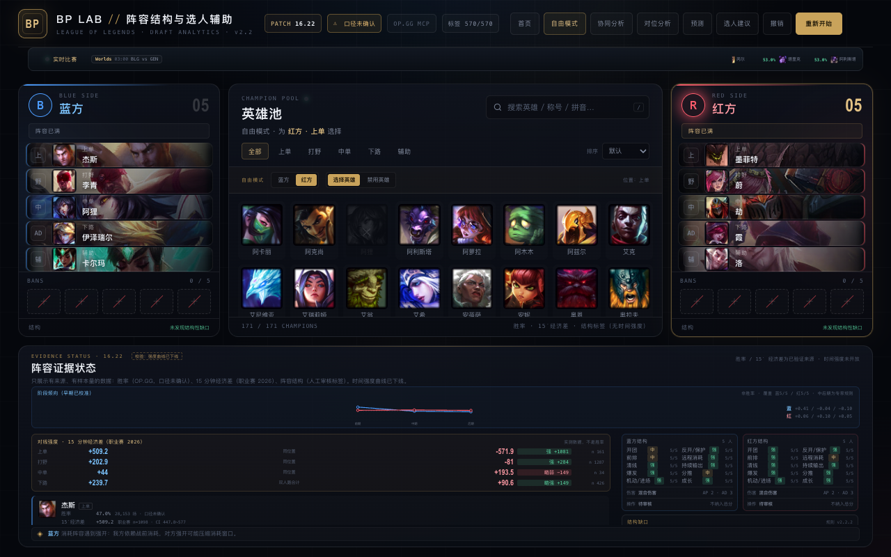

# BP LAB · 英雄联盟 BP 结构与选人辅助（v2.2）

一个可以直接打开使用的 LoL BP（Ban/Pick）原型。按 v2.2 方案：**OP.GG 已算好的统计直接用，BP LAB 只做组合解释、结构缺口与候选建议，不编造胜率**。





## 使用方法

直接双击 `index.html`（首页），点「进入 BP 工作台」或直接打开 `bp.html`（无需构建、无依赖）。若浏览器限制本地文件，可启动静态服务器：

```bash
python3 -m http.server 8080 --bind 127.0.0.1
# 打开 http://127.0.0.1:8080
```

## 实时比赛数据（可选）

```bash
npm install playwright-core          # 仅实时页需要
node scripts/live_poller.mjs 20000    # 常驻：20s 拉 lolesports，30min 刷新 OP.GG 结果
python3 scripts/fetch_esports_results.py   # 手动抓一次结果/赛程
```

不跑也不影响使用：首页会显示空状态，工作台可手动录 BP。

## 数据来源与许可

见 [DATA_LICENSES.md](DATA_LICENSES.md)。原始数据与 sqlite 不入库，可用 `scripts/fetch_public_datasets.sh` 重建。

## 这一版做了什么

- **标准 BP 顺序**：6 Ban → 6 Pick → 4 Ban → 4 Pick，共 20 手；另有自由模式。
- **英雄统计**：胜率 / 选取率 / 禁用率 / 分路梯队 / 排名 / 场次，全部带抓取时间与「口径未确认」标记。
- **首页**：实时比赛（lolesports 同源接口，20s 刷新）+ 最近比赛结果（OP.GG，队名/比分）+ 版本胜率 TOP；BP 接口当前不可达，可手动录入。
- **阶段倾向曲线（早期已校准）**：173 个英雄全覆盖（57 人工 + 116 DDragon+规则抽检）；早期权重用职业赛 15′ 经济差校准（英雄级 CV **0.374**、队伍级 **0.148**），中后期为专家规则。明确标注「非胜率」。
- **对线强度（15 分钟经济差）**：双方同一位置都选齐时，显示职业赛 2026 的 15′ 经济差对比与 强/略强/均势/略弱/弱 标签；下路用 ADC+辅助双人合计（如 伊泽瑞尔+卡尔玛 **+240** vs 霞+洛 **+91**）。
  - 这是**实测强度**，不是胜率；每项带场次 n 与 95% CI。
- **阵容证据状态**（替代原来的强度曲线）：每个已选英雄列出
  - 胜率 / 选取（OP.GG，口径未确认）
  - **15 分钟经济差**（职业赛 2026，ChainCC，含 n 与 95% CI）
  - 时间强度：**未开放**（旧曲线已下线，校验不通过）
  - 结构标签（人工审核）
- **阵容结构**：10 个维度（开团 / 反开保护 / 前排 / 远程消耗 / 清线 / 持续输出 / 爆发 / 分推 / 机动进场 / 成长）× 弱-中-强-未审核，双方并排。
- **结构缺口**：缺开团、无前排、后排无保护（结合敌方进场）、缺持续输出、缺清线、伤害类型单一等规则，带严重度与规则版本。
- **体系相克**：如"消耗阵容遇到强开"、"单带缺正面承伤"，只给机制解释和反例，**没有胜率百分比矩阵**。
- **协同分析**：只展示官方已有记录；缺记录显示「未提供」，位置不匹配显示原因，不回退到其他位置，也不加成到任何总分。
- **对位分析**：只比同路，方向以蓝方视角显示，反向换算会标注。
- **选人建议**：按 硬性约束 → 阵容缺口补位 → 同口径官方统计 → 风险与未知 四层排序，每张卡列出补位理由、统计、协同、对位、风险、未知项；**不输出预测胜率 / Pick EV / 综合分**。
- **下一手预测**：选人开始后，英雄池上方实时给出当前这一手的 Top 5（适配度 + 置信度 + 覆盖率），点一下直接选；点「预测」看完整拆解。
  - `适配度 = 20×阵容缺口 + 10×官方协同 + 5×同路对位 + 15×版本表现 + 10×伤害结构 + 40×分路热门度 − 5×非首选分路`
  - 缺失项**退出分母**而不是按 0 分算，覆盖率不足时置信度自动下调。
  - 这是启发式排序，**不是概率、不是胜率预测**。权重由 508 局真实排位对局做 70/30 时间切分网格搜索得到。

## 明确没有的东西

- ❌ 团队"阵容强度 ±N pp"
- ❌ 0–100 综合指数
- ❌ 用网页协同数据回退填充
- ❌ 把 Combo 胜率或对位胜率相加成"阵容胜率"
- ❌ 没有样本量却给置信区间

## 数据口径

| 来源 | 内容 | 口径 |
|---|---|---|
| OP.GG 官方 MCP（`lol_get_champion_analysis`） | 英雄-分路胜率/选取/禁用/梯队、counter、synergy、patch 趋势 | **未确认**（响应未返回地区/段位，`confirmed_cohort=null`） |
| OP.GG 网页快照（2026-11-11） | 5 段最终比赛时长条件胜率、图标、分路 | 自述韩服大师+、16.22；**该曲线已下线**，仅存档 |
| 人工审核标签 | 59 个热门英雄 × 10 维战术能力 | `champion_traits_v2.json`，其余英雄明确标未审核 |

版本号：Data Dragon `16.22.1`，官方补丁 `26.22`（两者编号不同，页面分开标注）。

## 目录

```
index.html                     首页（实时比赛 + 版本胜率）
bp.html                        BP 工作台（三栏 + 证据面板）
app.js                         BP 流程与渲染
engine.js                      纯函数分析引擎（Node 可测）
styles.css                     样式
data/bp_rules.json             维度/缺口规则/体系相克/候选分层/免责文案
data/champion_traits_v2.json   人工审核战术标签（59 英雄 × 10 维）
data/bp_contract.json|.js      合并合约（来源、口径、统计、时长桶、标签）
data/bp_lab_v22.sqlite         最小数据合同：source_snapshot / champion_traits / bp_analysis_cache
data/champions.json|.js        旧网页快照（原始数据，前端不再直接加载）
data/opgg_mcp.json|.js         MCP 快照（原始数据）
data/synergies.json|.js        旧网页协同（仅存档，已从产品逻辑移除）
scripts/build_v22_contract.py  合约构建器（唯一生成入口）
scripts/collect_ranked_drafts.py 通过 OP.GG MCP 采集真实排位对局
tests/failure-tests.mjs        v2.2 §8 的 12 条失败测试 + 7 条结构/预测回归（19 条）
tests/eval-prediction.mjs     下一手预测的命中率评估 + 权重网格搜索
data/ranked_drafts.sqlite     508 局韩服单排对局（评估用）
docs/BP_LAB_v2.2_实施说明.md    实施说明、限制与命令
modeling/                      旧的逐局建模探索（v2.1 路线，本版不作为产品前置）
```

## 公开数据（研究/校验用）

```bash
bash scripts/fetch_public_datasets.sh   # 下载到 data/raw/（约 46MB）
python3 tests/eval_real_draft.py data/raw/lol_draft_2026.inter   # 真实 BP 顺序回测
python3 tests/eval_lane.py data/raw/chaincc-players-2026.csv.gz  # 15 分钟对线校验
python3 scripts/build_lane_stats.py data/raw/chaincc-players-2026.csv.gz   # 单人强度
python3 scripts/build_lane_duos.py  data/raw/chaincc-players-2026.csv.gz   # 下路双人强度
```

| 数据集 | 许可 | 用途 |
|---|---|---|
| LoL-Draft 2026 | CC BY-SA 4.0 | 真实 20 手 BP 顺序（8,848 场） |
| ChainCC 2026 | CC BY 4.0 | 职业赛 10/15 分钟经济差（9,904 场）→ 单人 + 下路双人强度 |

## 更新流程

```bash
python3 scripts/build_v22_contract.py   # 改了 traits / rules / 快照后重建合约
node tests/failure-tests.mjs            # 必须 19/19 通过

# 评估"下一手预测"（可选：重新采集数据）
python3 scripts/collect_ranked_drafts.py --players-per-champion 3 --matches-per-player 20 --max-games 500
node tests/eval-prediction.mjs          # 当前权重 + 基线，输出 modeling/reports/prediction_eval.md
node tests/eval-prediction.mjs --tune   # 144 组权重网格搜索（70/30 时间切分）
```

## 为什么下线了"前中后期曲线"

用 ChainCC 职业赛 2026 的 15 分钟经济差校验旧曲线的「早期强度」标签（127 个英雄-分路）：

| 相关 | 早期最强 1/3 | 中间 1/3 | 早期最弱 1/3 |
|---|---|---|---|
| **−0.023**（95% CI −0.052~0.054） | −56 金币 | +42 金币 | −1 金币 |

相关约 0、分档不单调 → 该曲线测的不是英雄的早期强度，已从产品下线，只保留为研究数据。
替代指标：15 分钟经济差 / 经验差 / CS 差（职业赛，样本 <20 不展示）。

## 数据校验

用真实比赛校验过两件事（报告：[modeling/reports/curve_validation.md](modeling/reports/curve_validation.md)、[prediction_eval.md](modeling/reports/prediction_eval.md)）：

| 检验 | 数据（16.20–16.22 窗口） | 结果 |
|---|---|---|
| 英雄分路胜率能不能预测实际胜负 | 比赛级差分：996 局排位 + 8,800 局职业 | 职业 **AUC 0.515 / Q4−Q1 +1.9pp（CI 含 0）**；排位 +14pp 由极值英雄与水平混杂驱动 → 只能当**弱先验** |
| 时长曲线能不能预测“长局更强/更弱” | 同上 + 211 局职业（26.20–22） | 相关 **−0.01 ~ 0.08**；队伍合成 52~55%，CI 全部含 50 → **已下线** |
| 旧曲线“早期强度”是否等于真实对线表现 | 97,300 条职业赛记录（16.01–22） | 相关 **−0.023**，分档不单调 → **不成立** |
| 下一手英雄预测（伪顺序，已弃用） | 1,618 局韩服排位 | Top5 26.8%（仅供算法调试，不代表真实 BP） |
| **真实 BP 顺序回测** | 8,848 场职业赛 / 88,442 手 | 同补丁出场频率 Top5 **19.2%**（随机 3.1%）；版本与适配项**无增量** |

> 16.22 的职业比赛公开源尚未覆盖（OE 2026 下载配额超限、Leaguepedia 限流、gol.gg 动态渲染）；职业侧只有 26.20–22 的 211 局可用。

结论：**胜率当弱先验，时长曲线只做描述、不参与评分**。

## 已知限制

- 时长曲线与 MCP 统计**不同口径**，界面上分开标注、不相加。
- 没有桶级样本量，因此不提供 Wilson 区间，也不做跨英雄曲线排名。
- 标签只覆盖 59 个热门英雄；新英雄 `yunara`（芸阿娜）、`locke`（洛克）机制未核对，全部未审核。
- `tahmkench` 上单在旧快照中就没有时长曲线。
- OP.GG 数据使用条款状态仍为 `PENDING`，正式对外部署前需要复核。

详见 [docs/BP_LAB_v2.2_实施说明.md](docs/BP_LAB_v2.2_实施说明.md)。
